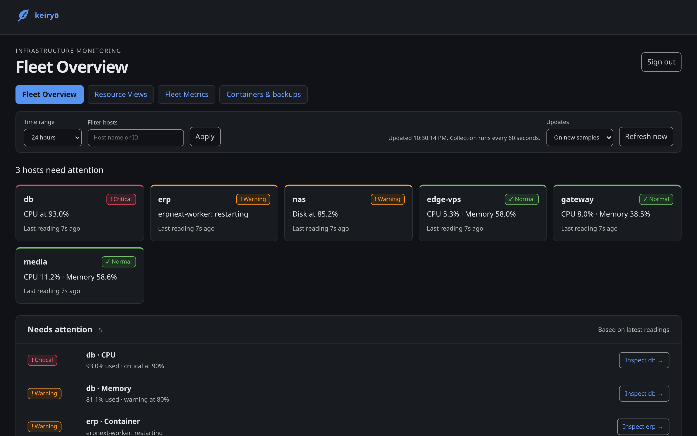
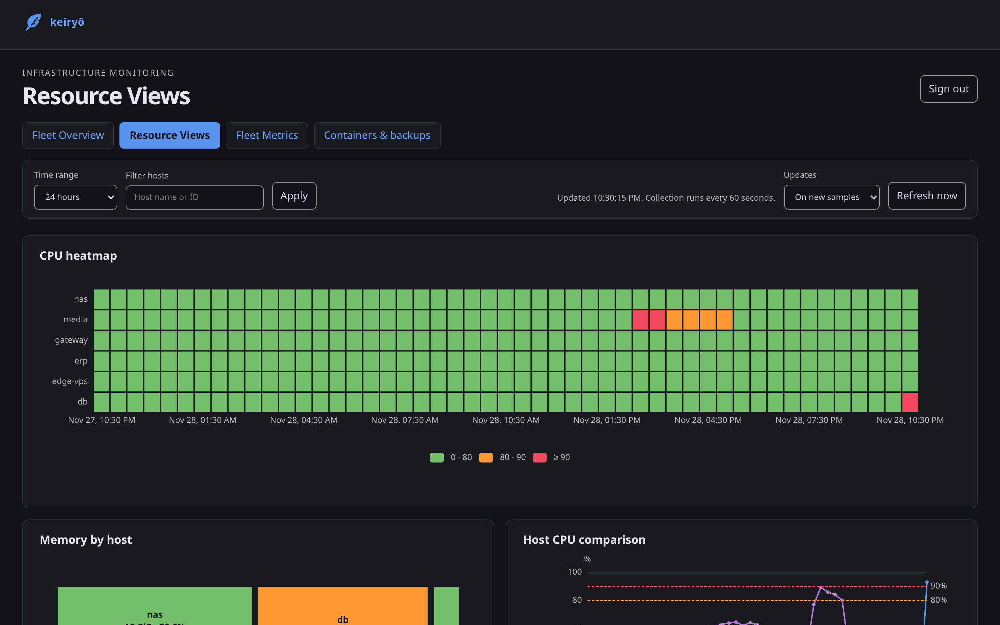
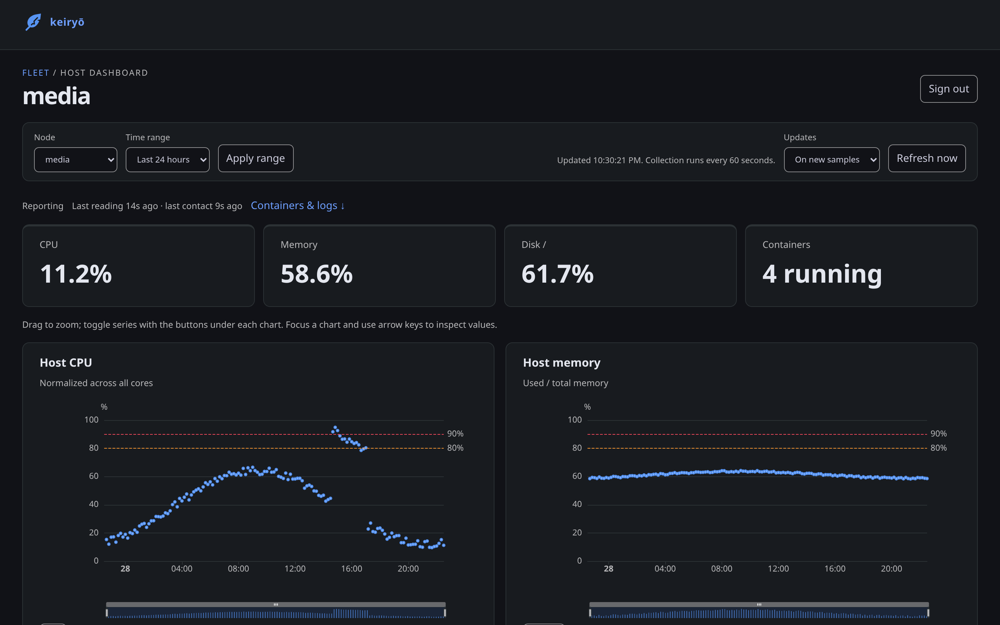
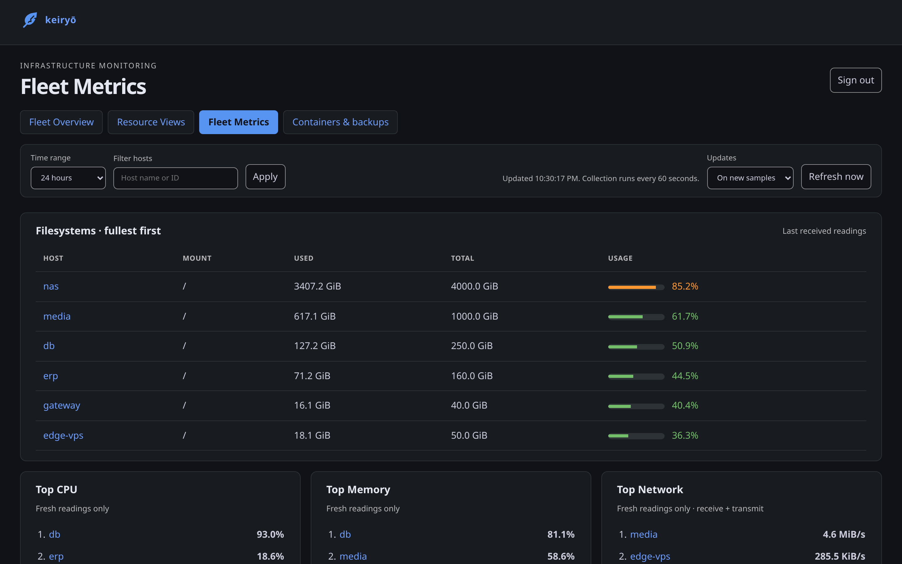
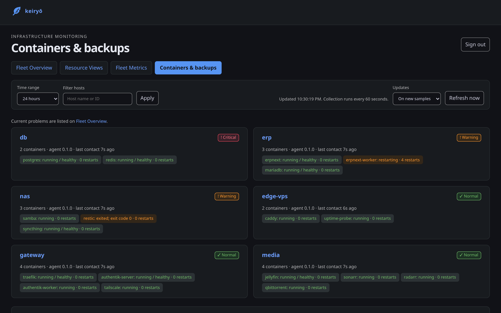
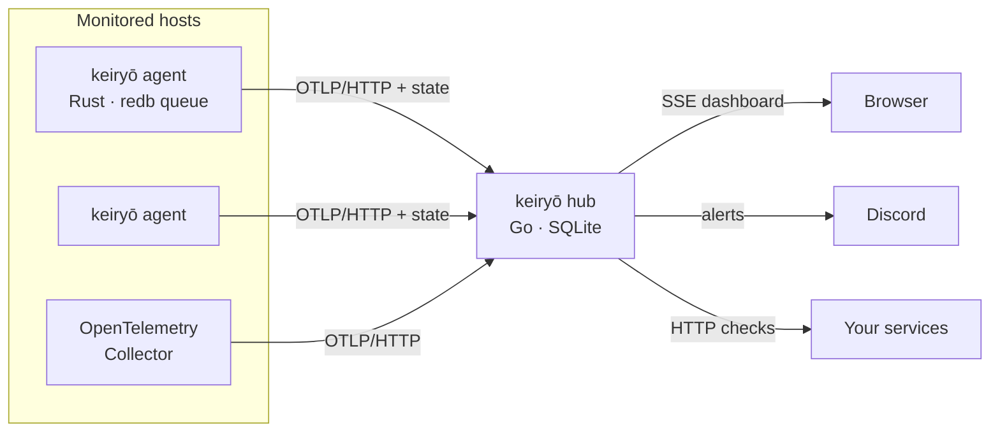

<div align="center">


# keiryō

**Lightweight, self-hosted server and Docker monitoring.**
A Go hub and Rust agents. OpenTelemetry (OTLP) ingest, SQLite history, a built-in dashboard and alerts. No external database, no CDN and no cloud account.

[](https://github.com/Connor-Ryan-1998/keiryo/actions/workflows/validate.yml)
[](https://github.com/Connor-Ryan-1998/keiryo/releases)
[](LICENSE)
[](https://github.com/Connor-Ryan-1998/keiryo/pkgs/container/keiryo)
[](go.mod)
[](agent-rust)



</div>

*keiryō (軽量) is Japanese for "lightweight".*

## Why keiryō?

Homelabs and small fleets need to know when a disk is filling, a container is
crash-looping or a backup hasn't run. Most of the tools that answer this need
several services, a time-series database and dashboards you assemble yourself.
keiryō is one hub and one small agent per host. It ships with useful views and
alerts out of the box, and stores history in a single SQLite file.

| | keiryō | Prometheus + Grafana | Netdata | Uptime Kuma |
| --- | --- | --- | --- | --- |
| Host + Docker metrics | ✅ | ✅ (with exporters) | ✅ | ❌ |
| Ready-made fleet dashboard | ✅ | Build or import | ✅ | Uptime only |
| Container logs on demand | ✅ | ❌ (needs Loki) | ❌ | ❌ |
| Backup freshness checks | ✅ | Custom | ❌ | Push monitors |
| HTTP checks | ✅ | Blackbox exporter | ✅ | ✅ |
| Storage | One SQLite file | TSDB | Per-node DB | SQLite |
| Services to run | Hub + agents | Prometheus, Grafana, exporters, Alertmanager | Agent per node (+ parent) | One |
| OpenTelemetry ingest | ✅ OTLP/HTTP | ✅ OTLP receiver | Varies by version | ❌ |

If you need arbitrary metrics, PromQL or long-term high-resolution storage,
use Prometheus. keiryō covers "is my fleet healthy?" with very little to run.

## Features

- **Host metrics:** CPU, memory, filesystems, network and uptime from a Rust agent (static binary, Linux and macOS).
- **Docker:** container state, health, restarts, exit codes and CPU/memory, plus **on-demand log snapshots** from the UI.
- **Alerts:** warning/critical thresholds with a pending period, plus optional **Discord** notifications.
- **Expected state checks:** containers that must exist, backup jobs that must succeed on time, and hub-side **HTTP(S) checks**.
- **Reliable delivery:** agents queue metrics on disk (redb) and replay them after hub or network outages of up to an hour.
- **OpenTelemetry:** agents speak OTLP/HTTP, and the hub accepts metrics from a stock OpenTelemetry Collector.
- **Fast, self-contained UI:** server-rendered pages with live updates (SSE), embedded ECharts, keyboard-accessible charts and no CDN.
- **Auth:** a built-in local admin account, or sign-in through a trusted reverse proxy (e.g. Authentik).
- **Small footprint:** one scratch container image for linux/amd64 and linux/arm64, with the SQLite history pruned on a retention schedule.

<table>
  <tr>
    <td></td>
    <td></td>
  </tr>
  <tr>
    <td></td>
    <td></td>
  </tr>
</table>

## Architecture



The hub has two listeners. A private **agent listener** (`:9081`) takes metrics,
state and log responses, with one bearer token per host. A **UI listener**
(`:9080`) serves the dashboard.

## Quickstart (Docker Compose)

Monitor the machine you're on with the published image:

```sh
git clone https://github.com/Connor-Ryan-1998/keiryo.git
cd keiryo/examples/docker
./init.sh               # creates the shared token and data dirs (uses sudo)
docker compose up -d
```

Open <http://127.0.0.1:9080>, sign in with **admin / admin**, choose a new
password and sign in again. CPU and network rates appear after about a minute.

The hub listens on loopback only. Before exposing it, put a TLS reverse proxy in
front and read [authentication and network boundary](docs/reference.md#authentication-and-network-boundary).
To monitor more hosts, give each one its own token and agent config
([persistent setup](docs/reference.md#persistent-local-setup)).

### Other ways to run it

- **Release binaries:** releases include static `keiryo_<version>_linux_{amd64,arm64}.tar.gz`
  archives with a `SHA256SUMS` file. Run `./monitoring hub -config hub.json` or
  `./monitoring agent -config agent.json`. Start from the [hub](examples/hub.json)
  and [agent](examples/agent.json) examples.
- **Container image:** `ghcr.io/connor-ryan-1998/keiryo:latest`, or a pinned version tag.
- **Try it from source without installing anything:** `uv sync --locked && uv run --locked task preview`
  starts a throwaway hub and agent for your machine and deletes everything on Ctrl+C.
  This needs Go, Rust, [Task](https://taskfile.dev/) and [uv](https://docs.astral.sh/uv/);
  see [CONTRIBUTING.md](CONTRIBUTING.md).

## Configuration and safety

- Each host needs its own token file. Never commit credentials or databases.
- Keep first-run bootstrap private; never expose it through a public tunnel.
- Docker socket access is effectively host-root access, even with a read-only mount.
- Remote traffic needs HTTPS or a private encrypted network; the app has no built-in TLS.
- Back up before upgrading. Upgrade the hub before agents; rollback may need an older database backup.
- Missing readings are shown as unavailable, never as zero. keiryō is not a general-purpose OTLP backend.

## Documentation

- [Configuration fields and alert policy](docs/reference.md#configuration)
- [Discord notifications](docs/reference.md#discord-notifications)
- [Backup freshness monitoring](docs/reference.md#expected-backup-jobs) and [HTTP checks](docs/reference.md#http-checks)
- [OTLP, durable delivery and upgrades](docs/reference.md#opentelemetry-metrics)
- [Authentication and proxy requirements](docs/reference.md#authentication-and-network-boundary)
- [Storage, backups and limits](docs/reference.md#storage-backups-and-limits)
- [Troubleshooting](docs/reference.md#preview-and-troubleshooting)
- [Contributing](CONTRIBUTING.md) · [Releasing](docs/releasing.md) · [Security policy](SECURITY.md)

## License

[Apache License 2.0](LICENSE). Third-party components are listed in [THIRD_PARTY.md](THIRD_PARTY.md).
